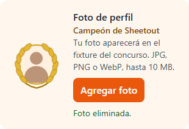

# Concurso: publicación y recorrido del colaborador

Verificado el 11/10/2026 sobre `codex/competition-registration`, actualizado desde GitHub hasta `a5d7446`, conservando el trabajo local del ranking de líderes.

## Qué verá al publicar

En **Concurso → Configuración → Publicar al equipo**, el concurso queda disponible para colaboradores y trainers de su tienda. En el encabezado del panel personal aparece el botón naranja **MI CONCURSO**, junto a **Cambiar contraseña**. El panel comprueba la publicación al abrirse, recuperar el foco y cada 15 segundos mientras está visible.

El colaborador encuentra cuatro secciones. El líder de equipo ve únicamente **Mi concurso**, **Fixture** y **Ranking**: hace seguimiento y no se inscribe.

| Sección | Qué muestra / permite |
| --- | --- |
| Mi concurso | Equipo, trainer, compañeros, puntos personales y áreas/fases propias. El trainer ve las participaciones de sus integrantes y el promedio del equipo. |
| Inscripción | Elegir hasta dos áreas entre Landing, Landing Crazy, Vestido, Sheetout, Masa, Drive Thru y Servicio. Muestra inscritos y el mínimo necesario por área. |
| Fixture | Selector de área, cruces, turnos sorteados, fases, resultados y avance. |
| Ranking | Clasificación individual, equipos y trainers. |

El administrador debe asociar al colaborador a un equipo antes de que pueda inscribirse. **Publicar un borrador abre las inscripciones**: puede retirar una elección y sustituirla hasta la activación. Cada elección se guarda en el servidor y persiste al recargar.

**Activar concurso** cierra las inscripciones y sortea el fixture. Cada área con inscripciones necesita al menos dos inscritos elegibles; las áreas vacías no compiten. Los cruces organizan el orden de evaluación. Cada persona avanza por cumplir calidad y tiempo, y los resultados finales determinan el campeón. Las fases y el ranking se actualizan con los resultados guardados.

**Ocultar al equipo** retira el acceso y la lectura del concurso, conservando integrantes, inscripciones, evaluaciones y puntos. La publicación y el estado deportivo son independientes.

## Resultado de las pruebas

- 114 pruebas JavaScript aprobadas y compilación de producción correcta, incluidas foto, certificación y conservación de las habilidades previas. La comprobación de tipos de Next.js también pasó.
- Las ocho suites PostgreSQL del concurso pasaron: publicación/permisos, perfiles vigentes, trainers vigentes, promedio por líder, elección de áreas, rúbricas, ciclo deportivo y reconocimientos/certificación. También pasó la suite SQL de fotos.
- E2E del colaborador: trece comprobaciones aprobadas. Incluye el panel real, publicación, URL oculta, dos elecciones, tercera bloqueada, retiro/sustitución, recarga, cierre, fixture, avance a Fase 2, puntos, ranking, ocultación, subida/reemplazo/eliminación de foto y silueta de persona predeterminada cuando no hay foto. El líder no tiene inscripción en escritorio, móvil ni al recargar; consulta las áreas de su equipo y su llamada directa de inscripción se rechaza.
- E2E de evaluación: doce comprobaciones aprobadas. Incluye cronómetro, pausa, recuperación, confirmación, 90 aprobado/89 rechazado, error crítico, tiempo excedido, reinicio, cuatro fases, campeón, promedio, certificación de estación al 100%, foto con laureles y corrección auditada que retira los laureles. La selección de comprobaciones descuenta los puntos automáticos del cronómetro; superar el tiempo máximo deja 85/100 aunque se cumplan todas las comprobaciones manuales.
- Prueba adicional de navegador de publicación/ocultación aprobada.
- Sin excepciones de página, errores de consola ni errores de API en el recorrido del colaborador.

Estas pruebas usan **los componentes React, las migraciones, las RPC y los permisos PostgreSQL reales**, sobre una base PGlite nueva y desechable. La autenticación y el transporte son adaptadores de prueba; el adaptador del perfil incorpora los reconocimientos persistidos y la misma función de lectura de capacitación del producto. Los widgets del panel ajenos al concurso se omiten. No prueban el inicio de sesión ni Realtime reales de Supabase o el recorrido con una cuenta de producción.

La prueba de foto usa archivos reales, transformación JPEG en el navegador y políticas Storage de PostgreSQL; el transporte de archivos es de prueba. La suite `scripts/test-profile-photos.mjs` verifica propiedad, rutas, roles, publicación, otra tienda y reemplazo/eliminación. La migración de fotos ya está instalada en producción: véase [Fotos de perfil](CONCURSO.md#fotos-de-perfil).

La suite `scripts/test-competition-leaders-followup.mjs` confirma el bloqueo de líderes por identidad y equipo, incluso con un rol de cuenta distinto o un vínculo histórico como integrante, conservando la inscripción de colaboradores y el promedio del líder. La captura `output/collaborator-e2e/14-lider-seguimiento.png` muestra la vista móvil del líder.

La revisión remota de solo lectura confirmó que Firebase responde y sus archivos públicos contienen el botón MI CONCURSO, publicación, inscripción, Sheetout, rúbricas por comprobaciones y fixture. Supabase rechaza lecturas anónimas de las tablas/vistas consultadas. Esto no certifica todas las migraciones remotas ni los permisos de una sesión autenticada. No se publicó, activó ni modificó ningún concurso de producción.

## Capturas e informes

Ejemplo versionado de un campeón sin foto, con la silueta predeterminada y laureles:



Los artefactos se guardan en `output/`, excluido de Git:

- `output/collaborator-e2e/informe.md`, `resultado.json` y `trace.zip`.
- `01-panel-oculto.png`, `02-panel-publicado.png` y `03-mi-concurso.png`.
- `04-inscripcion-desktop.png` y `05-inscripcion-mobile.png`.
- `06-fixture-desktop.png`, `07-fixture-mobile.png` y `09-fixture-avance.png`.
- `08-mi-concurso-resultado.png` y `10-ranking-colaborador.png`.
- `11-panel-foto.png` y `12-fixture-foto.png`.
- `output/evaluation-e2e/`: informe, resultados, traza y capturas de evaluación y ranking del líder; `certificacion-concurso.png`, `fixture-laureles.png`, `perfil-campeona-mobile.png` y `perfil-campeona-sin-foto.png` muestran los reconocimientos, incluidos laureles sobre la silueta predeterminada.

## Repetir las pruebas

En un entorno Linux en la nube:

```sh
npm ci
npm install --prefix tmp/competition-test-runtime --no-audit --no-fund @electric-sql/pglite@0.3.16 playwright@1.58.2
node tmp/competition-test-runtime/node_modules/playwright/cli.js install --with-deps chromium
npm run test:competition:e2e
```

Instalar los ejecutores aislados de las dependencias de la aplicación:

```powershell
npm install --prefix tmp/competition-test-runtime --no-audit --no-fund @electric-sql/pglite@0.3.16 playwright@1.58.2
node tmp/competition-test-runtime/node_modules/playwright/cli.js install chromium
npm run test:competition:e2e
```

El comando inicia y detiene automáticamente servidores locales en los puertos 4191 y 4192, con datos nuevos para cada suite. En Windows detecta Chromium instalado en la caché de Playwright. Se pueden indicar `PGLITE_MODULE`, `PLAYWRIGHT_MODULE` y `CHROMIUM_PATH` para usar otros ejecutores instalados. Los módulos deben ser nombres de paquetes o URL `file:///`.

Para explorar manualmente un borrador oculto, desde PowerShell:

```powershell
$env:PGLITE_MODULE = ([System.Uri](Join-Path $PWD 'tmp/competition-test-runtime/node_modules/@electric-sql/pglite/dist/index.js')).AbsoluteUri
$env:COMPETITION_QA_MODE = 'collaborator'
$env:COMPETITION_QA_PORT = '4190'
node scripts/serve-competition-qa.mjs
```

Abrir administración en `http://127.0.0.1:4190/concurso?role=admin` y, en otra pestaña, el panel personal en `http://127.0.0.1:4190/staff?role=collaborator`. También existen identidades ficticias `rival` y `trainer`. Cada reinicio del servidor comienza desde cero. El servidor escucha exclusivamente en localhost.
